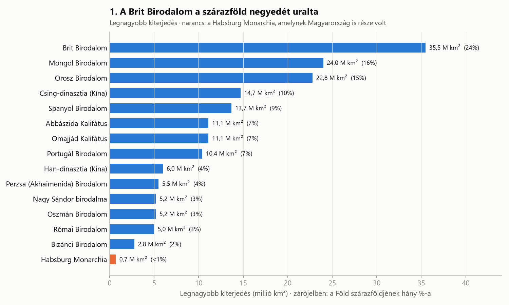
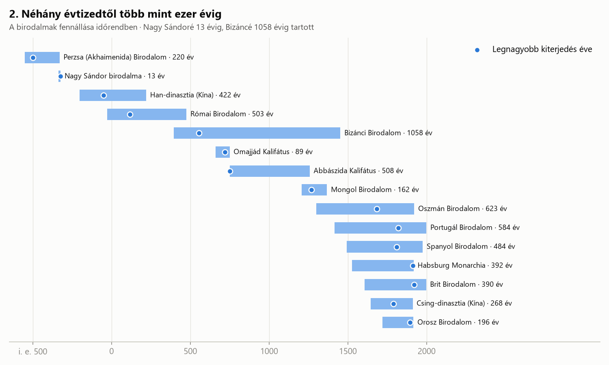
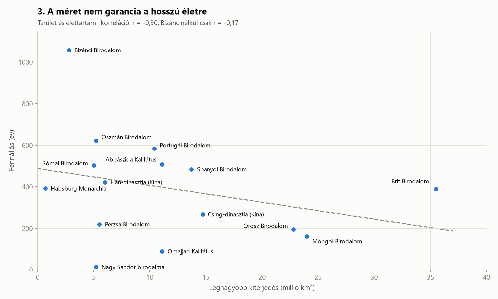

# Birodalmak felemelkedése és bukása

> Melyik volt a történelem legnagyobb birodalma? Meddig maradtak fenn a nagy birodalmak? És tényleg igaz, hogy minél nagyobbra nő egy birodalom, annál hamarabb omlik össze?

---

## Bevezetés

Tizenöt birodalmat hasonlítottam össze az ókori Perzsiától a Brit Birodalomig. Minden birodalomnál két dolgot vizsgáltam: **mekkora területet uralt a csúcspontján**, és **hány évig állt fenn**. Összehasonlításképp bekerült a Habsburg Monarchia is, amelynek Magyarország is része volt.

Előre kell bocsátani, hogy egy birodalom kezdetének és végének meghatározása gyakran vita tárgya. Mikor kezdődött a Római Birodalom: a köztársaság alapításakor, vagy Augustus császárrá válásakor (i. e. 27)? Mikor ért véget a Mongol Birodalom, amely néhány évtized után több kánságra szakadt? A diagramokon a történészek által leggyakrabban használt évszámokat alkalmaztam.

---

## 1. A Brit Birodalom a szárazföld negyedét uralta

A **Brit Birodalom** 1920 körül **kb. 35,5 millió km²**-t, vagyis a Föld szárazföldjének negyedét uralta. Innen ered a mondás, hogy „a birodalomban sosem nyugszik le a nap”: mindig volt egy brit gyarmat, ahol éppen nappal volt.

A második a **Mongol Birodalom** 24 millió km²-rel. Ez viszont **a valaha volt legnagyobb összefüggő birodalom**: a britekkel ellentétben a mongolok szárazföldön, lóháton hódítottak, Koreától egészen Magyarországig (a muhi csata 1241-ben).

Feltűnő, hogy az ókor híres birodalmai, Róma és Perzsia, „csak” 5–6 millió km²-esek voltak. Ennek oka nem a gyengeségük volt, hanem a technológia: lóháton, vitorlás hajóval és futárokkal ennél nagyobb területet szinte lehetetlen volt egyben tartani. A gőzhajó és a távíró nélkül a Brit Birodalom sem létezhetett volna.

A Habsburg Monarchia (narancs) kb. 0,7 millió km²-rel elenyészőnek tűnik a listán. Ez jól mutatja, mekkora léptékkülönbség van egy európai nagyhatalom és egy világbirodalom között.

---

## 2. Néhány évtizedtől több mint ezer évig

Az idővonal minden birodalom fennállását mutatja, a pont pedig azt az évet jelöli, amikor a legnagyobb volt.

A szélsőségek:

- **Nagy Sándor birodalma: 13 év.** Sándor i. e. 323-ban 32 évesen meghalt, és a birodalmat a hadvezérei azonnal felosztották egymás között.
- **Bizánci Birodalom: 1058 év.** A Római Birodalom keleti fele egészen 1453-ig, Konstantinápoly oszmán elfoglalásáig fennmaradt.

Érdekes megfigyelni, *mikor* érték el a birodalmak a csúcsukat. Sokuk a fennállásának első felében volt a legnagyobb (Bizánc, Omajjádok, Abbászidák), utána fokozatosan zsugorodtak. A gyarmatbirodalmak (brit, spanyol, portugál) viszont a végük előtt nem sokkal voltak a legnagyobbak, majd a 20. században gyorsan szétestek.

Az idővonal egy magyar szálat is mutat: a Habsburg Monarchia 1526-ban, a mohácsi csata után került a magyar trónra, és 1918-ig, az első világháború végéig maradt fenn.

---

## 3. A méret nem garancia a hosszú életre

A gyakori elképzelés szerint minél nagyobb egy birodalom, annál nehezebb egyben tartani, és annál hamarabb omlik össze. Igaz ez?

A szórásdiagramon minden pont egy birodalom: vízszintesen a területe, függőlegesen az élettartama. A szaggatott vonal a lineáris trend.

A **korrelációs együttható r = -0,30**. Ez gyenge negatív összefüggés: a nagyobb birodalmak *kicsit* rövidebb ideig éltek. Ha azonban kivesszük egyetlen kiugró pontot, a **Bizánci Birodalmat**, a korreláció **r = -0,17**-re csökken, ami gyakorlatilag már semmi.

### Adattudományi tanulságok

1. **Egyetlen kiugró érték (outlier) is jelentősen megváltoztathatja az eredményt**, ha kevés az adat. 15 pont nagyon kis minta, ilyenkor mindig érdemes megnézni, mi történik, ha az extrém pontokat elhagyjuk.
2. **A definíciókon is múlik.** Ha a Mongol Birodalom végét 1294-re tennénk (amikor ténylegesen szétesett), vagy a Római Birodalom kezdetét a köztársaság alapítására, más eredményt kapnánk.
3. **A terület nem az egyetlen tényező.** A Brit és a Mongol Birodalom is óriási volt, mégis teljesen eltérő ideig maradt fenn. Sokkal fontosabbnak tűnik az utódlás rendje, a gazdaság, a technológia és a szomszédok ereje.

---

## Összegzés

1. **A modern technológia új léptéket hozott:** a gőzhajó és a távíró tette lehetővé, hogy a Brit Birodalom a szárazföld negyedét uralja.
2. **Az élettartamok nagyon eltérőek:** Nagy Sándor 13 évétől Bizánc 1058 évéig.
3. **A méret és a hosszú élet között nincs erős kapcsolat.** Ami gyenge összefüggés látszik, az is nagyrészt egyetlen kiugró birodalomnak köszönhető.

A birodalmak nem a méretük miatt buktak el, hanem azért, mert a világ megváltozott körülöttük. A kérdés tehát nem az, mekkorára nő egy birodalom, hanem hogy mennyire tud alkalmazkodni.

---

### Adatforrás és módszertan

- **Forrás:** Wikipedia – „List of largest empires” (Rein Taagepera és Peter Turchin becslései alapján), valamint az egyes birodalmak szócikkei.
- **Terület:** a birodalom legnagyobb becsült kiterjedése millió km²-ben. A Föld szárazföldjének területe kb. 148,9 millió km².
- **Élettartam:** a történészek által leggyakrabban használt kezdő és záró évszám különbsége.
- A korrelációt a `numpy.corrcoef` függvénnyel számoltam (Pearson-féle korrelációs együttható).
- A diagramokat a `birodalmak_vizualizacio.py` script készíti (Python, pandas, numpy, matplotlib).
