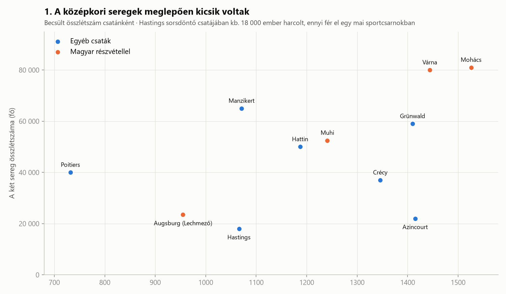
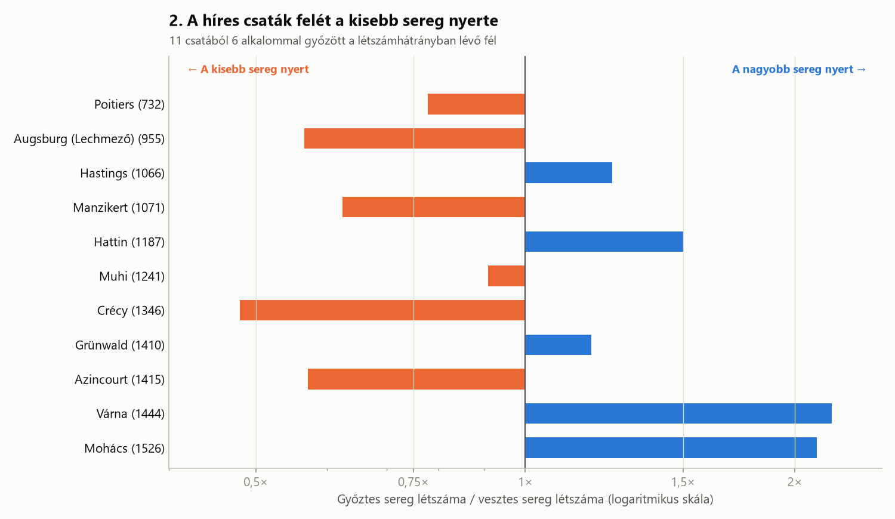
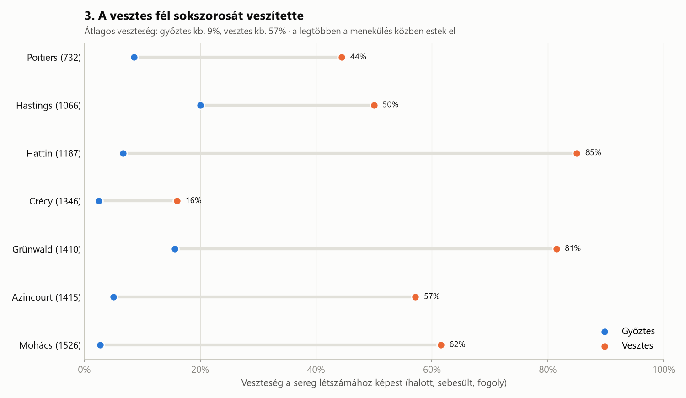

# Középkori csaták számokban (732–1526)

> A filmekben a középkori csaták végtelen seregek összecsapásai, ahol a hős ügyesség dönt. De mit mondanak a számok? Mekkora seregek harcoltak valójában, mindig a nagyobb nyert-e, és kik haltak meg?

---

## Bevezetés

Tizenegy híres csatát vizsgáltam meg 732 és 1526 között, Poitiers-től Mohácsig. Négy közülük magyar vonatkozású: Augsburg (955), Muhi (1241), Várna (1444) és Mohács (1526).

**Fontos figyelmeztetés:** a középkori létszámadatok nagyon bizonytalanok. A korabeli krónikások gyakran tízszeresére nagyították az ellenséget, hogy a győzelem még dicsőbb legyen. A modern történészek becslései is tartományok, például „7 000–12 000 fő”. A diagramokon ezeknek a tartományoknak a közepét használtam. Az egyes számok tehát nem pontosak, de a nagyságrendek és a mintázatok megbízhatóak.

---

## 1. A középkori seregek meglepően kicsik voltak

Hastingsnél 1066-ban, abban a csatában, amely eldöntötte Anglia sorsát, a két oldalon összesen **kb. 18 000 ember** harcolt. Ennyi néző fér el egy nagyobb mai sportcsarnokban. Az Augsburgnál (Lechmezőn) összecsapó seregek is együtt csak kb. 23 500 főt számláltak.

A legnagyobb csaták a korszak végén jöttek: **Várna (1444)** és **Mohács (1526)** egyaránt kb. 80 000 résztvevővel. Ez nem véletlen. Az Oszmán Birodalom állandó, központilag fizetett hadsereget tartott fenn (például a janicsárokat), így sokkal nagyobb sereget tudott kiállítani, mint a feudális királyságok, ahol a király a nemesei hűségére és a saját kíséretükre volt utalva.

A narancssárga pontok a magyar részvételű csatákat jelölik. Jól látszik, hogy a Magyar Királyság a korszak végére az oszmán hódítás frontvonalába került, és ott a legnagyobb seregekkel kellett szembenéznie.

---

## 2. A híres csaták felét a kisebb sereg nyerte

A diagram minden csatánál azt mutatja, hányszor nagyobb (vagy kisebb) volt a győztes sereg a vesztesnél. Jobbra (kék) a nagyobb sereg nyert, balra (narancs) a kisebb.

**11 csatából 6-ot a létszámhátrányban lévő fél nyert.** A legszélsőségesebb példa **Crécy (1346)**: az angolok fele akkora sereggel győzték le a franciákat, főleg a hosszúíjászok és a jó védekező állás miatt. **Azincourt (1415)** szinte ugyanez a történet hetven évvel később, ugyanazzal az eredménnyel. A szűk, sáros terepen a francia túlerő nem tudott kibontakozni.

A magyar csatáknál viszont a nagyobb sereg nyert: **Várnánál és Mohácsnál kétszeres oszmán túlerő** állt szemben a magyar sereggel.

### Adattudományi csapda: a szelekciós torzítás

Jelenti-e ez, hogy a középkorban mindegy volt a létszám? **Nem.** Ez a diagram jó példa a **szelekciós torzításra** (selection bias). Azért ezeket a csatákat ismerjük, mert híresek, és egy csata gyakran éppen attól lesz híres, hogy a kisebb sereg váratlanul győzött. Az a több száz csata, ahol a nagyobb sereg a várakozásoknak megfelelően nyert, nem került be a tankönyvekbe, így az én adathalmazomba sem.

Ha a középkor *összes* csatáját vizsgálnánk, valószínűleg jóval erősebb előnyt látnánk a nagyobb seregeknél. A tanulság: **az eredmény attól is függ, hogyan választottuk ki az adatokat.**

---

## 3. A vesztes fél sokszorosát veszítette

Ahol van megbízható becslés a veszteségekre, ott egy nagyon egyértelmű mintázat rajzolódik ki. **A győztes átlagosan a seregének kb. 9%-át veszítette el, a vesztes kb. 57%-át.**

Ennek oka, hogy a középkori csatákban a legtöbb ember nem a harc közben halt meg, hanem **a menekülés során**. Amíg a sorok kitartottak, a veszteségek mindkét oldalon mérsékeltek voltak. Amikor azonban az egyik fél megtört és futni kezdett, a lovasság üldözőbe vette és lekaszabolta a hátat fordító katonákat.

- **Hattin (1187):** a keresztes sereget víz nélkül körbezárták a sivatagban. Szinte az egész sereg elesett vagy fogságba került (kb. 85%), és Szaladin még abban az évben elfoglalta Jeruzsálemet.
- **Grünwald (1410):** a Német Lovagrend serege gyakorlatilag megsemmisült, a nagymestert is beleértve.
- **Mohács (1526):** a magyar sereg kb. 62%-a odaveszett, köztük II. Lajos király is, aki a menekülés közben a Csele-patakba fulladt. Az oszmánok vesztesége ehhez képest csekély volt.

---

## Összegzés

A három diagram együtt egészen más képet ad a középkori háborúról, mint a filmek:

1. **A seregek kicsik voltak**, gyakran csak néhány ezer fő oldalanként, és csak az állandó hadsereggel rendelkező államok tudtak igazán nagy sereget kiállítani.
2. **A létszám nem volt minden.** A terep, a fegyverzet (hosszúíj) és a taktika sokszor fontosabbnak bizonyult, bár a híres csaták adatai a szelekciós torzítás miatt felnagyítják ezt a hatást.
3. **A csata igazi tragédiája a menekülés volt.** A vesztes oldal szinte mindig sokszor nagyobb veszteséget szenvedett, mint a győztes.

Magyar szemmel ez a történet Mohácsnál zárul: a csata után az ország három részre szakadt, és a Habsburgok kezdték uralni a királyság nyugati részét. Hogy ez hogyan illeszkedik a nagy birodalmak történetébe, az már egy másik diagram témája.

---

### Adatforrás és módszertan

- **Forrás:** Wikipedia, az egyes csaták szócikkei (angol és magyar nyelvű változat).
- A létszámoknál és a veszteségeknél a becslési tartományok közepét használtam, kerekítve. A **veszteség** itt halottat, sebesültet és foglyot is jelent.
- Ahol nincs elfogadott becslés (például a mongolok vesztesége Muhinál), ott a csatát kihagytam a 3. diagramból.
- A diagramokat a `csatak_vizualizacio.py` script készíti (Python, pandas, matplotlib).
