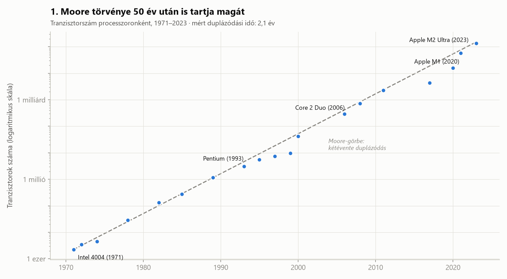
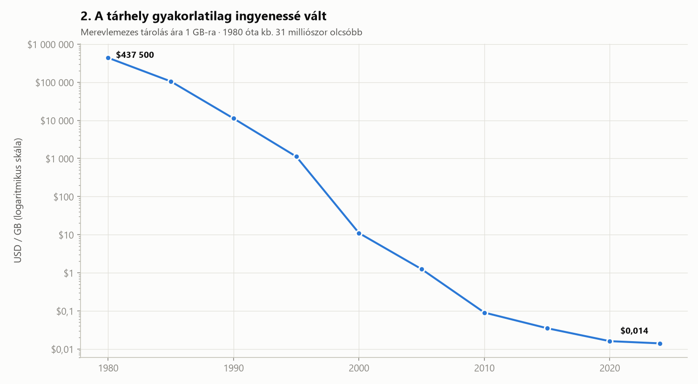
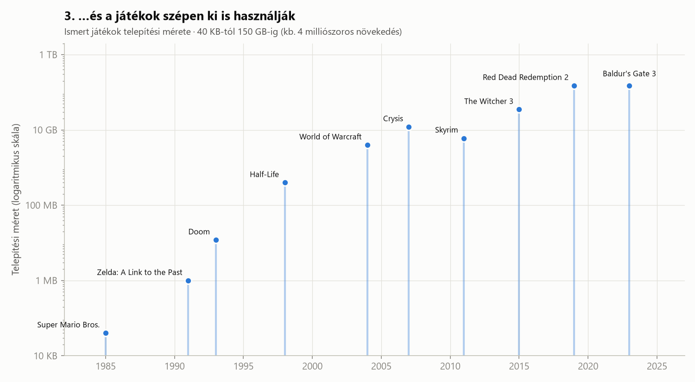

# Moore törvénye: 50 év a számítógépek fejlődésében

> Hogyan lett egy 1965-ös cikk mellékes megjegyzéséből fél évszázadnyi technológiai fejlődés menetrendje? És mi köze ennek ahhoz, hogy a Baldur's Gate 3 150 GB helyet foglal a gépeden?

---

## Bevezetés: egy jóslat, ami önmagát teljesítette be

1965-ben Gordon Moore, a később az Intelt is alapító mérnök egy szakmai lapban felfigyelt egy furcsa szabályszerűségre. Az egy chipre zsúfolható alkatrészek száma évről évre nagyjából megduplázódott. 1975-ben pontosította a jóslatát: **kétévente duplázódás**. Ezt nevezzük ma Moore törvényének.

Ez valójában nem fizikai törvény, hanem egy megfigyelés. Az iparág azonban évtizedeken át céldátumként kezelte. A chipgyártók úgy tervezték a fejlesztéseiket, hogy tartsák a tempót, így a jóslat részben saját magát teljesítette be.

A következő három diagram azt mutatja be, hogy **mit jelent ez a számokban**, és **hová lett ez a rengeteg új teljesítmény**.

---

## 1. Moore törvénye 50 év után is tartja magát

Az első processzor, az **Intel 4004 (1971)** körülbelül 2 250 tranzisztort tartalmazott. Az **Apple M2 Ultra (2023)** nagyjából 134 milliárdot, ami **60 milliószoros** növekedés 52 év alatt.

A szaggatott vonal Moore „ideális” görbéje: kétévente duplázódás a 4004-től indulva. A kék pontok a valódi processzorok. Ha egyenest illesztünk a pontokra (logaritmikus skálán), a **mért duplázódási idő 2,1 év**, tehát Moore 1975-ös becslése meglepően pontosnak bizonyult.

**Miért logaritmikus a skála?** Lineáris skálán az első 40 év pontjai mind a nullánál lapulnának, és csak az utolsó néhány chip látszana. Logaritmikus skálán viszont az exponenciális növekedés **egyenes vonallá** válik, így ránézésre ellenőrizhető, hogy a tempó állandó maradt-e. Mindhárom diagram ezért logaritmikus skálát használ.

Érdemes megfigyelni azt is, hogy a 2010-es évek közepén néhány pont a görbe alá csúszik. Ekkor kezdett a hagyományos tranzisztorzsugorítás lassulni a fizikai határok miatt. A gyártók új trükkökkel (3D tranzisztorok, több chip egy tokban) zárkóztak fel újra.

---

## 2. A tárhely gyakorlatilag ingyenessé vált

Ugyanez a miniatürizálás nemcsak a processzorokat, hanem a **tárolást** is átalakította. 1980-ban egy gigabájtnyi merevlemezes tárhely nagyjából **437 500 dollárba** került volna, ennyi pénzből akkor egy házat is lehetett venni. 2024-ben ugyanez kb. **1,4 cent**.

Ez körülbelül **31 milliószoros** árcsökkenés. A legmeredekebb esés az 1990-es években volt: 1995 és 2000 között százszor olcsóbb lett a tárhely, éppen akkor, amikor az otthoni PC-k és az internet berobbantak.

A 2010 utáni szakasz ellaposodik. A merevlemezek ára már nem esik olyan gyorsan, mert a fejlődés áttevődött az SSD-kre és a felhőbe. Ez fontos tanulság: **egyik exponenciális trend sem tart örökké**.

---

## 3. …és a játékok szépen ki is használják

Hová lett ez a sok tranzisztor és olcsó tárhely? Részben ide.

- **Super Mario Bros. (1985):** kb. 40 KB. Ez kisebb, mint egy mai átlagos e-mail.
- **Doom (1993):** kb. 12 MB, és a 3D-s lövöldözős játékok őse lett.
- **Half-Life (1998):** kb. 400 MB, CD-ROM-on érkezett.
- **World of Warcraft (2004):** kb. 4 GB.
- **The Witcher 3 (2015):** kb. 35 GB.
- **Red Dead Redemption 2 (2019)** és **Baldur's Gate 3 (2023):** kb. 150 GB.

A növekedés nagyjából **4 milliószoros** 38 év alatt, nagyságrendileg ugyanaz a tempó, mint a tranzisztorszámé. A játékfejlesztők mindig pontosan annyi helyet és teljesítményt használtak ki, amennyit a hardver éppen lehetővé tett: nagyobb felbontású textúrákat, hangalámondást, nyitott világokat.

Érdekes kivétel a **Skyrim (2011)**, amely kisebb volt, mint a négy évvel korábbi Crysis. A méret tehát nem csak a technológián múlik, hanem a tervezési döntéseken is. Ugyanez igaz a Minecraftra: a világ legtöbbet eladott játéka ma is csak néhány száz MB, mert a világát a gép generálja, nem a lemezről tölti be.

---

## Összegzés

A három diagram együtt egy láncot mutat:

1. **A chipek kétévente kétszer annyi tranzisztort kapnak**, így gyorsabbak és hatékonyabbak lesznek.
2. **A tárolás milliószor olcsóbb lett**, így a hely gyakorlatilag már nem szűk keresztmetszet.
3. **A szoftverek, és különösen a játékok, azonnal kitöltik a rendelkezésre álló teret.**

Egy fontos adattudományi megjegyzés: a három trend **párhuzamosan** mozog, de ebből önmagában nem következik, hogy egyik okozza a másikat. Itt a kapcsolat azért valószínű, mert van mögötte ismert mechanizmus. A fejlesztők a meglévő hardverre terveznek, a gépigények ezt közvetlenül mutatják. A korreláció önmagában azonban nem bizonyíték.

Moore törvénye ma lassul: a tranzisztorok már csak néhány tucat atom szélesek. A fejlődés viszont nem áll meg, csak irányt vált. Speciális chipek (GPU-k, AI-gyorsítók) és új architektúrák veszik át a stafétát. Hogy a következő 50 év is egyenes vonal lesz-e a logaritmikus skálán, azt majd a jövő diagramjai mutatják meg.

---

### Adatforrások és módszertan

- **Tranzisztorszám:** Wikipedia – *Transistor count*; Our World in Data. A duplázódási időt a `log2(tranzisztorszám)` ~ `év` lineáris illesztés meredekségéből számoltam.
- **Tárolási ár:** John C. McCallum – *Disk Drive Prices*; Our World in Data. Nominális (nem inflációval korrigált) dollárárak, 5 évenkénti kerekített értékek.
- **Játékméretek:** kiadói minimális gépigények és Wikipedia. Kerekített, közelítő értékek. A patchek és DLC-k miatt a mai méretek eltérhetnek.
- A diagramokat a `moore_vizualizacio.py` script készíti (Python, pandas, matplotlib).
