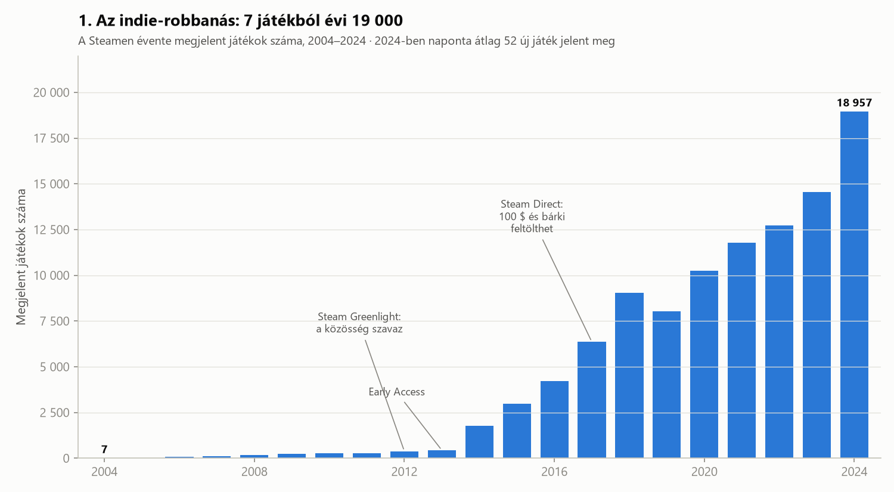
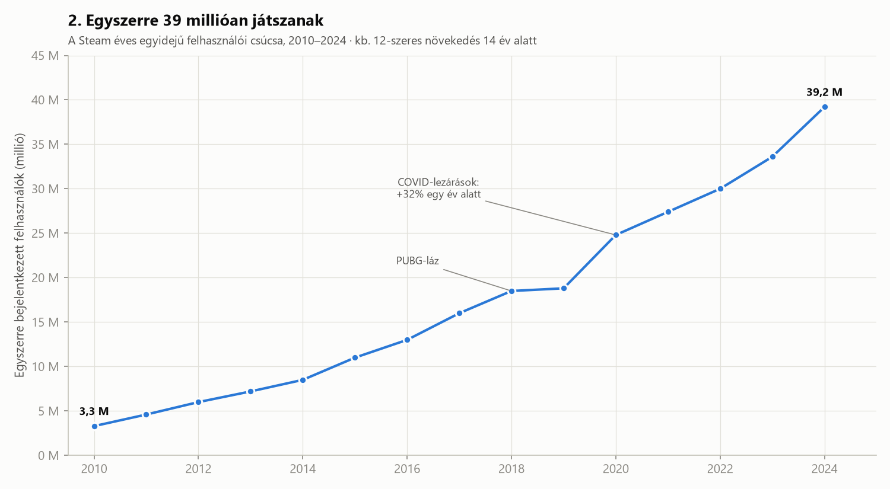
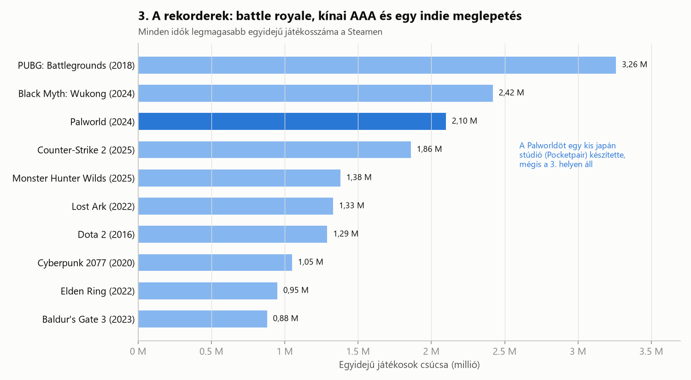

# Steam: 20 év PC-s játékozás számokban

> 2003-ban a Steam még csak egy bosszantó program volt, ami frissítéseket töltött le a Counter-Strike-hoz. Ma ez a PC-s játékok legnagyobb piactere, ahol naponta több mint 50 új játék jelenik meg. Hogyan történt ez?

---

## Bevezetés

A Valve 2003-ban indította el a Steamet, hogy egyszerűbben frissíthesse a saját játékait. 2004-ben a Half-Life 2 már csak Steamen keresztül futott, és sok játékos ekkor kénytelen volt telepíteni. Az elején a platformot sokan utálták. Húsz évvel később szinte minden PC-s játékos használja.

A következő három diagram azt mutatja be, hogyan nőtt a **játékkínálat**, a **játékosbázis**, és **melyik játékok döntöttek rekordot**.

---

## 1. Az indie-robbanás: 7 játékból évi 19 000

2004-ben **7 játék** jelent meg a Steamen, csak válogatott kiadóktól. 2024-ben **kb. 19 000**, vagyis naponta átlagosan 52.

A grafikon nem egyenletesen nő, hanem a Valve döntéseire reagálva ugrik:

- **Steam Greenlight (2012):** a játékosok szavazhattak, melyik független (indie) játék kerüljön fel a boltba. 2014-re a megjelenések száma megnégyszereződött.
- **Early Access (2013):** a fejlesztők már a félkész játékot is árulhatták. Ebből nőtt ki többek között a Rust, a Valheim és a Baldur's Gate 3 korai változata is.
- **Steam Direct (2017):** a szavazás megszűnt, helyette bárki feltölthet egy játékot játékonként 100 dollárért. A kínálat innentől szinte robbanásszerűen nő.

Az egyetlen visszaesés 2019-ben volt. Ennek valószínű okai, hogy a Valve ekkor kezdett fellépni a gyenge minőségű, gyorsan összedobott játékok ellen, és 2018 végén elindult az Epic Games Store, amely exkluzív szerződésekkel csábított el játékokat.

A hatalmas kínálatnak ára is van: egy átlagos új játéknak nagyon nehéz feltűnnie a tömegben. Ma már nem a megjelenés a nehéz, hanem az, hogy valaki észre is vegye a játékot.

---

## 2. Egyszerre 39 millióan játszanak

Az egyidejű felhasználók csúcsa azt mutatja meg, hány ember volt egyszerre bejelentkezve a Steamre. 2010-ben ez kb. **3,3 millió** volt, 2024-ben már **39,2 millió**, ami kb. **12-szeres** növekedés.

Két kiugrás látszik a görbén:

- **2018 – PUBG-láz:** a PlayerUnknown's Battlegrounds egymaga milliókat hozott a platformra, főleg Kínából.
- **2020 – COVID:** a lezárások alatt emberek milliói maradtak otthon, és egy év alatt **32%-kal** nőtt a csúcs. A legérdekesebb, hogy a járvány után sem esett vissza: akik akkor kezdtek PC-n játszani, többnyire ott is maradtak.

A 2019-es stagnálás egybeesik az első diagram visszaesésével. Mindkettő a PUBG utáni lecsengést és az Epic Games Store indulását tükrözheti, de ezt a két grafikon alapján nem lehet biztosan kijelenteni.

---

## 3. A rekorderek: battle royale, kínai AAA és egy indie meglepetés

Melyik játékot játszották egyszerre a legtöbben a Steam történetében?

1. **PUBG (2018), 3,26 millió:** a battle royale műfaj robbanása. A rekordot azóta sem döntötte meg semmi.
2. **Black Myth: Wukong (2024), 2,42 millió:** egyjátékos kínai akciójáték. Megmutatta, hogy a kínai piac önmagában is rekordokat tud dönteni.
3. **Palworld (2024), 2,10 millió:** a meglepetés. Egy kis japán stúdió, a Pocketpair készítette, és már korai hozzáférésben (Early Access) rekordot döntött. Az első diagram 2013-as döntése nélkül ez a siker nem jöhetett volna létre.

Érdemes megfigyelni, hogy a top 10-ben kevés a klasszikus „örök” multiplayer játék. A Dota 2 és a Counter-Strike ott van, de a lista nagy részét **újonnan megjelent játékok** adják, amelyek a megjelenésük körüli napokban értek csúcsra. A hype a Steamen hatalmas, de gyakran rövid életű.

---

## Összegzés

1. **A Valve döntései alakították a piacot.** A Greenlight, az Early Access és a Steam Direct mind látható töréspontot hagytak a megjelenési adatokban.
2. **A közönség tartósan nőtt.** A COVID alatt szerzett játékosok nagy része maradt.
3. **Az indie esély valódi, de ritka.** A Palworld sikere megmutatja, hogy egy kis stúdió is a csúcsra érhet, de ugyanabban az évben kb. 19 000 másik játék is versenyzett a figyelemért.

Adattudományi megjegyzés: az egyidejű csúcs nem ugyanaz, mint a „legnépszerűbb játék”. Egy játék, amit kevesebben, de évekig játszanak (például a Counter-Strike vagy a Dota 2), összességében sokkal több játékórát gyűjthet, mint egy rövid ideig hype-olt rekorder. **A mérőszám megválasztása eldönti, ki a győztes.**

---

### Adatforrások és módszertan

- **Megjelenések évente:** SteamDB és Statista („Number of games released on Steam”).
- **Egyidejű felhasználók:** SteamDB, az adott év legmagasabb mért értéke, kerekítve.
- **Játékos-csúcsok:** SteamDB és SteamCharts, minden idők legmagasabb egyidejű játékosszáma (a Steamen kívüli platformok nélkül).
- Minden érték kerekített, közelítő adat.
- A diagramokat a `steam_vizualizacio.py` script készíti (Python, pandas, matplotlib).
